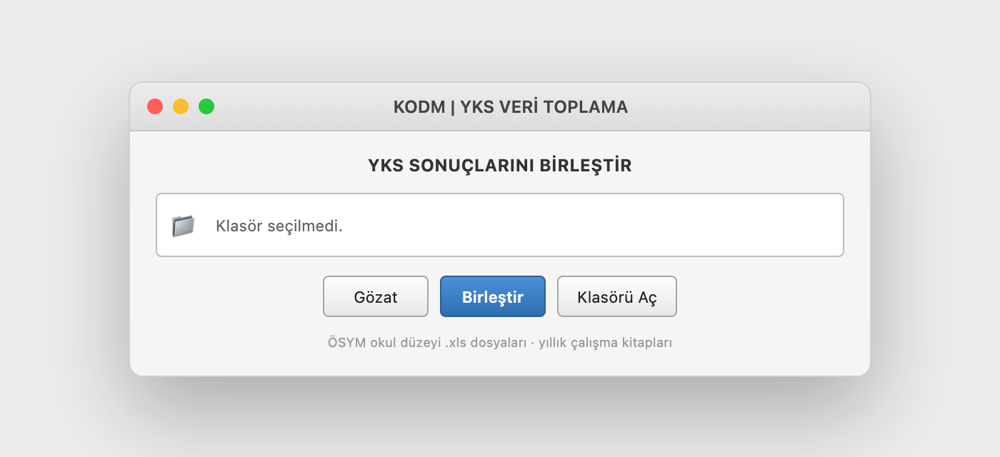

# YKS Veri Birleştirme

> A tiny desktop tool that merges ÖSYM YKS school-level Excel exports into clean yearly workbooks.

[](https://www.python.org/)
[](#usage)
[](LICENSE)

<p align="center">
  <a href="https://www.buymeacoffee.com/cmtrkr"></a>
</p>

YKS Veri Birleştirme is a small Tkinter application for district education offices. Point it at a folder tree of `.xls` files exported from ÖSYM, and it walks every subfolder, reads each workbook, groups sheets by type, and writes one merged `.xlsx` per sheet type into `~/Documents`.

It is intentionally simple: no database, no server, no installation wizard — one Python script and a native window.

## 📸 Screenshot

<p align="center">
  
  <br>
  <sub>Representative preview built from the app's real Tkinter layout and labels — not a screen capture.</sub>
</p>

## ✨ Features

- 🖥️ **Native Tkinter GUI** — choose a folder, press **Birleştir**, watch the progress bar.
- 🔎 **Recursive scan** — walks district → school subfolders and processes every `.xls` file.
- 📑 **Sheet-aware merging** — supported sheet types:
  - `OkulAytTestSonucListesi`
  - `OkulYksTestSonucListesi`
  - `OkulYksPuanlariListesi`
  - `OkulYksYerlestirmePuanlariListe`
- 🗂️ **Yearly outputs** — writes `YIL_<SheetName>_birlesmis.xlsx` to `~/Documents`.
- ⚠️ **Skip reporting** — files with unexpected headers are skipped and listed at the end.
- 📦 **PyInstaller ready** — `gui.spec` builds a standalone desktop app.
- 🧾 **Extended variant** — `app_xlsx.py` adds `.xlsx` support and a log file.

## 📋 Requirements

- Python 3.8+
- `pandas`, `xlrd`, `openpyxl`

```bash
python3 -m pip install --user pandas xlrd openpyxl
```

## 🚀 Usage

```bash
python3 app.py
```

1. Click **Gözat** and choose the root folder that contains district folders.
2. Click **Birleştir**.
3. The merged workbooks appear in your Documents folder.
4. Use **Klasörü Aç** to open the output folder.

Expected input layout:

```text
input/
├── district-1/
│   ├── school-1/*.xls
│   └── school-2/*.xls
└── district-2/
    └── school-1/*.xls
```

For `.xlsx` inputs, run `app_xlsx.py` instead.

## 🏗️ Project structure

```text
├── app.py          # Tkinter GUI + .xls merge logic
├── app_xlsx.py     # Extended .xlsx variant with logging
├── gui.spec        # PyInstaller build spec
├── odm.ico         # Windows icon
└── input/          # Example input tree
```

## 📦 Build a standalone app

```bash
pyinstaller --noconsole gui.spec
```

## ⚠️ Notes

- The UI is in Turkish.
- The parser expects ÖSYM's school-level sheet layout, including the header at `df.iloc[1,5]`. Different exports may be skipped.
- Merges can take a while for large district trees; keep the app window open.
- Always keep the original `.xls` files; the tool only writes new `.xlsx` outputs.
- Not an official ÖSYM application.

## ❤️ Support

If this saves you a day of copy-paste, you can buy me a coffee:

<p align="center">
  <a href="https://www.buymeacoffee.com/cmtrkr"></a>
</p>

## 📄 License

[MIT](LICENSE) © 2026 Cem Türker.
